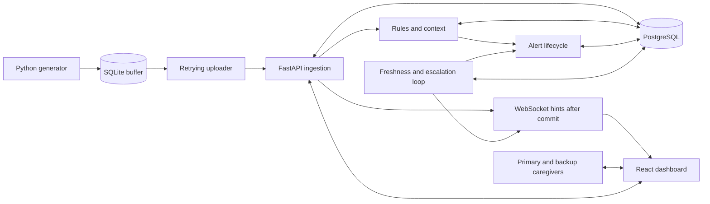
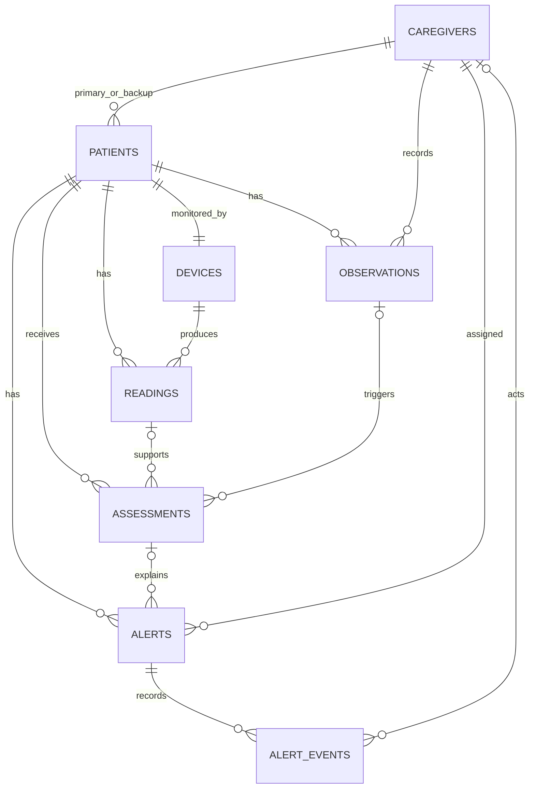

# Approved architecture

Baseline recorded on 2026-11-06. This document specifies planned behavior. Actual progress is tracked in [IMPLEMENTATION_PLAN.md](IMPLEMENTATION_PLAN.md). Rationale is recorded in [DECISIONS.md](DECISIONS.md).

## Objective and selected challenges

Build an Intelligent Home Healthcare Monitoring and Response System for Operation Ward Zero. The workflow is patient data → monitoring → risk assessment → alert → caregiver response.

The user confirmed that participants may address selected challenges. Deep implementation focuses on reliability and alert response. Vital monitoring, historical context, and caregiver response tracking support that workflow. Forecasting and attendance tracking are excluded from the initial scope.

The supplied judging weights are integration 25%, technical skills 20%, resilience 20%, practical implementation 20%, and explainability/clinical safety 15%. The supplied brief is the requirements baseline. The event page did not expose readable rules during planning.

The budget is 48 hands-on development hours. Use three fictional adult patients, one device per patient, five-second sampling, and two demo caregivers. Deliver locally with in-app notifications and an identity selector.

## Components and stack

| Component | Technology and responsibility |
|---|---|
| Application | Python, FastAPI, Pydantic, one Uvicorn worker, REST, rules, lifecycle operations, periodic checks, WebSockets, compiled frontend serving |
| Persistence | PostgreSQL, SQLAlchemy 2 async, asyncpg, Alembic migrations |
| Simulator | Python generation, SQLite persistent buffer, independent uploading and retries |
| Dashboard | React, TypeScript, Vite, TanStack Query, Recharts |
| Packaging | Docker Compose, named PostgreSQL and simulator volumes |
| Verification | pytest/HTTPX, Vitest/Testing Library, small Playwright suite |

Pin compatible stable versions during M0. Three services run in the demonstration. Backend modules cover ingestion, patient/history queries, rules/trends, observations, alerts, database operations, realtime updates, and health. SQLite uses explicit transactions, default journaling, and synchronous=FULL.

The simulator keeps a durable copy until storage is confirmed. PostgreSQL holds authoritative application state. The browser reloads that state after interruptions.

## Ingestion and durability

For a new reading, validate input, resolve its patient from the registered device, lock the patient row, check identity, insert the reading, evaluate rules, save assessment and alert changes with audit events, and commit. Return success only after commit. Broadcast update hints afterward.

All patient-affecting mutations use the same patient-first locking order. A failure before commit rolls back the complete operation. A failure after commit but before the response is recovered by an idempotent retry.

The simulator assigns a UUID and persistent device sequence before upload. Its buffer records payload, pending/accepted/quarantined status, attempt count, next retry time, and last error. Sampling continues independently of network requests. Upload oldest first, one frame at a time, with a three-second timeout. Retry network errors, 408, 429, and 5xx using 1/2/4/8/15-second capped backoff with jitter and Retry-After support. Quarantine permanent failures visibly. Stop generation with an unhealthy status if local persistence fails.

Identical repeated readings return success without repeating side effects. Conflicting reuse of an ID or device sequence returns 409. Preserve buffered records during the hackathon. The guarantee starts after local durable commit and assumes available storage and intact volumes.

## Rules, context, and freshness

Assess concern as none/watch/high and data quality as fresh/incomplete/stale/unavailable. Show last known concern with its timestamp when current assessment is unavailable. Use the UI wording “No configured concern detected” for complete evidence without a firing rule.

These approved thresholds are fictional demonstration parameters. They provide no clinically validated alarm protocol. Strict comparisons apply, and high takes precedence.

| Metric | Watch | High |
|---|---|---|
| Heart rate, bpm | <50 or >110 | <40 or >130 |
| SpO2, percent | <94 | <90 |
| Systolic BP, mmHg | <90 or >160 | <80 or >180 |
| Diastolic BP, mmHg | <50 or >100 | <40 or >120 |
| Temperature, Celsius | <36 or >38 | <35 or >39 |

Evaluate available measurements immediately, including high breaches in incomplete frames. Save rule ID/version, values/units, condition, evidence IDs/timestamps, contributing observations, and current/historical scope.

For trends, compare medians of two adjacent one-minute windows. Require eight valid samples per metric per window and no gap over ten seconds across the two-minute window. A SpO2 decline of at least three percentage points or heart-rate increase of at least 20 bpm produces watch. Otherwise report the calculated change or insufficient continuous history.

Structured observations support breathlessness, dizziness, and reduced_intake. Store present true/false, actor, server time, and optional note up to 500 characters. The latest observation per tag applies for ten minutes. False clears that tag. Any active concern floors priority at watch. Breathlessness combined with a current SpO2 threshold breach or falling-SpO2 trend raises high. Clearing an observation cannot suppress another firing rule. Free text is displayed without interpretation. Reevaluate on observation expiry.

| Timing | Approved default |
|---|---|
| Sampling | Every five seconds per patient |
| Delivery delay badge | Receipt more than ten seconds after observation |
| Current eligibility | Newest reading at most 30 seconds old |
| Staleness | No complete reading observed within 30 seconds |
| Future timestamp rejection | More than five seconds ahead |
| Periodic checks | Every five seconds |
| High/watch escalation | 30/60 seconds without acknowledgement |
| WebSocket heartbeat | Ten seconds |
| Connected/disconnected polling | 15/five seconds |

Retain delayed and out-of-order readings in history. Preserve the current pointer's time ordering. Evaluate absolute thresholds for historical input and aggregate concerns into delayed-review alerts. Full retrospective trend recomputation is outside scope. Subsequent eligible trend windows may use recovered history.

## Alert lifecycle

Kinds are risk, monitoring_gap, and delayed_review. Status transitions are open → acknowledged → resolved. Escalation updates assignment and history.

- Keep one active episode per patient and kind. Repeated concerns update it.
- Preserve peak priority and original evidence while exposing current evidence.
- A higher priority reopens an acknowledged episode and requires acknowledgement again.
- Save deadlines in PostgreSQL. Escalate unacknowledged alerts once from primary to backup.
- An alert already assigned to backup remains visibly unacknowledged without another escalation tier.
- Acknowledgement stops the pending escalation timer.
- Risk resolution requires acknowledgement, a note, and three consecutive fresh complete readings with no firing rules.
- Monitoring-gap alerts automatically resolve after three fresh complete readings.
- Delayed-review resolution requires acknowledgement and a review note.

The lifespan-managed periodic loop checks freshness, expired observations, and due escalations. Process overdue work before startup readiness. Readiness checks database availability, migrations, and loop health. Health checks assist startup ordering, while application retries handle later outages.

## Database

Use UUID keys, UTC timestamptz, explicit foreign keys, constrained statuses, typed measurement columns, and JSONB explanation snapshots.

| Table | Important fields and responsibility |
|---|---|
| caregivers | id, display_name for seeded identities |
| patients | id, display_name, primary/backup caregiver FKs, latest_reading_id, current_assessment_id, monitoring_started_at, revision |
| devices | id, patient_id FK, label, one device per patient |
| readings | id, device_id/patient_id FKs, sequence, observed_at, received_at, five vital columns, payload_hash |
| observations | id, patient_id/caregiver_id FKs, tag, present, note, created_at, expires_at |
| assessments | id, patient_id FK, optional reading/observation FKs, trigger_kind, scope, concern, data_quality, findings, rule_version, evaluated_at |
| alerts | id, patient_id FK, kind, status, peak_priority, assignee_id, latest_assessment_id, lifecycle timestamps/actors, escalation_due_at, escalated_at, revision |
| alert_events | id, alert_id FK, event_type, optional caregiver_id, optional unique command_id, occurred_at, details |

Enforce unique reading ID and (device_id, sequence), unique device per patient, unique non-null command_id, and a partial unique (patient_id, kind) index for open/acknowledged alerts. Derive reading patient_id from the device server-side.

Index reading history by (patient_id, observed_at DESC, id), observations by (patient_id, tag, created_at DESC), assessments by (patient_id, evaluated_at DESC), inboxes by (assignee_id, status, opened_at DESC), due open alerts by escalation_due_at, and events by (alert_id, occurred_at).

Approximately 51,840 frames arrive daily at the planned rate. Retain all hackathon records without automatic cleanup. Use ordinary tables. Startup preserves existing data. A future real-data retention policy requires a separate decision.

## Public interfaces

REST uses /api/v1, UUID strings, UTC RFC 3339 timestamps, and explicit units. Error envelopes contain error.code/message/details and request_id. Lists contain items and next_cursor. Return 422 for validation, 409 for identity or state conflicts, and 503 for unavailable persistence.

Reading input contains reading_id, device_id, sequence, observed_at, heart_rate_bpm, spo2_pct, systolic_mmhg, diastolic_mmhg, and temperature_c. Vital keys may be null for missing measurements. Validate finite values, SpO2 0–100, positive HR/BP, and consistent BP ordering.

Assessment output includes id, patient_id, scope, concern, data_quality, evaluated_at, rule_version, findings, and trend_summary. Alert output includes identity, kind/status, peak_priority, assignee, lifecycle/deadline timestamps, latest_assessment, and revision.

Local reads require no login. Actor mutations carry X-Demo-Caregiver-Id for attribution and enforce assignment server-side. Sensor ingestion requires an environment-configured X-Simulator-Key. Publish loopback ports only.

| Method and route | Input | Output and access |
|---|---|---|
| GET /health/live | None | Process status, local |
| GET /health/ready | None | Status, database, worker_last_success_at, local, 503 when unready |
| POST /api/v1/readings | Reading input | reading_id, disposition, received_at, assessment_id, sensor key, 201 new/200 duplicate |
| GET /api/v1/dashboard | None | server_time, caregivers, patients, active_alerts, system_status, local |
| GET /api/v1/patients/{id} | Path ID | patient, latest_reading, current_assessment, active_observations, local |
| GET /api/v1/patients/{id}/readings | from, to, cursor, limit | Paginated readings, default last 30 minutes and 500 rows, maximum 2,000, local |
| POST /api/v1/patients/{id}/observations | observation_id, tag, present, optional note | observation and assessment, assigned primary/backup actor, 201 new/200 replay |
| GET /api/v1/alerts | patient_id, assignee_id, status, cursor, limit | Paginated alerts, default 50/max 200, local |
| GET /api/v1/alerts/{id} | Path ID | alert and events, local |
| POST /api/v1/alerts/{id}/acknowledge | command_id | Updated alert, current assignee |
| POST /api/v1/alerts/{id}/resolve | command_id, note | Updated alert, current assignee, 409 if conditions fail |
| GET /api/v1/rules | None | version, thresholds, trend_rules, timing, local |

Reuse observation UUIDs and action command IDs until the result is known. Replays produce no duplicate lifecycle events. Conflicting ID reuse returns 409. Generate frontend API types from /openapi.json during implementation.

WebSocket /api/v1/ws emits patient.updated, alert.updated, system.status, and heartbeat. Its envelope includes type, optional patient_id/alert_id/revision, and server_time. Refetch dashboard and selected patient on connection/reconnection. Retain periodic polling. Bound outbound queues and disconnect slow clients so ingestion remains independent.

The simulator CLI will support run, scenario <patient> <stable|deterioration|recovery|missing>, status, replay <reading-id>, and verify. Store selected scenarios in SQLite. Exercise real network/service interruptions.

## Dashboard and operational evidence

Use one page with three patient cards, selected vitals and timestamps, quality status, a selectable-metric chart, explanations, observations, caregiver inbox filtering, lifecycle controls/history, and synchronization status. Pair colors with text/icons. Confirm mutations only after server success. Retain failed drafts visibly.

For recovery verification, stop generation and drain the queue. Compare identifier sets so locally committed IDs equal the disjoint union of server-stored, pending, and quarantined IDs. Valid fully drained fixtures must all exist on the server.

The system processes new evidence when backend availability returns. Persistent volumes cover process/container recovery. Human acknowledgement explicitly records caregiver response. A WebSocket send alone supplies no proof of human receipt.

## References retained from planning

The design uses documented PostgreSQL uniqueness and locking behavior. [Constraints](https://www.postgresql.org/docs/current/ddl-constraints.html) and [locking](https://www.postgresql.org/docs/current/explicit-locking.html).

Single-process WebSocket connections and startup lifecycle handling follow FastAPI capabilities. [WebSockets](https://fastapi.tiangolo.com/advanced/websockets/) and [lifespan](https://fastapi.tiangolo.com/advanced/events/).

SQLite durability settings and Compose readiness are operational references. [SQLite synchronous](https://www.sqlite.org/pragma.html#pragma_synchronous) and [Compose startup order](https://docs.docker.com/compose/how-tos/startup-order/).
