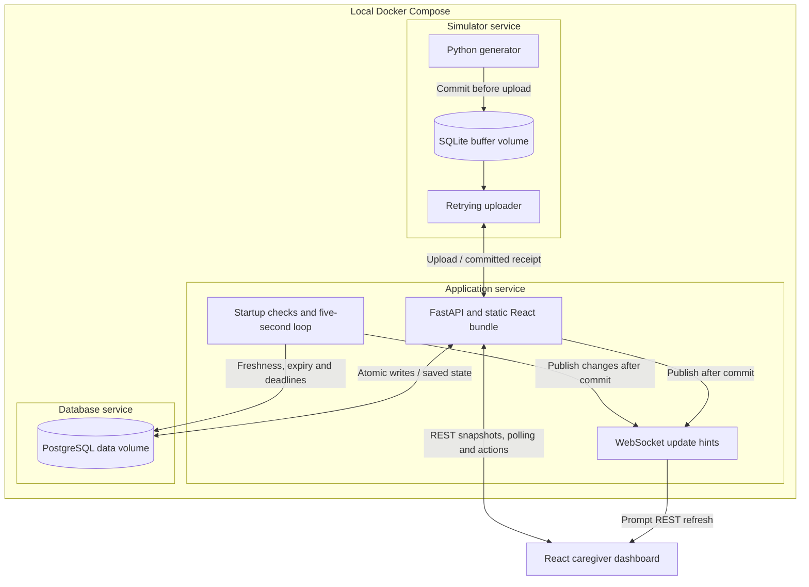
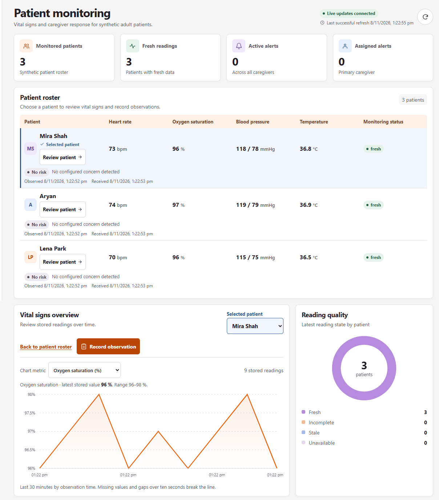
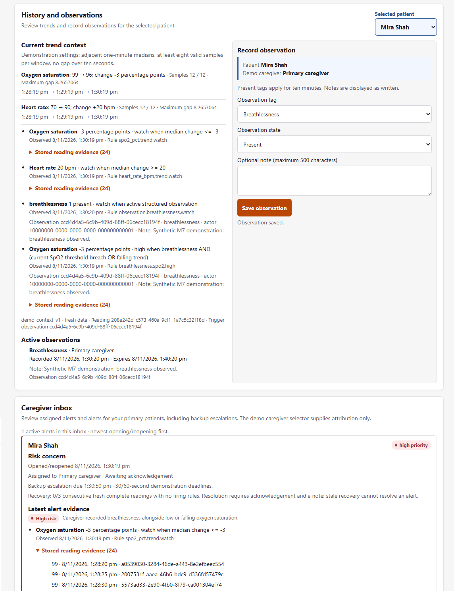
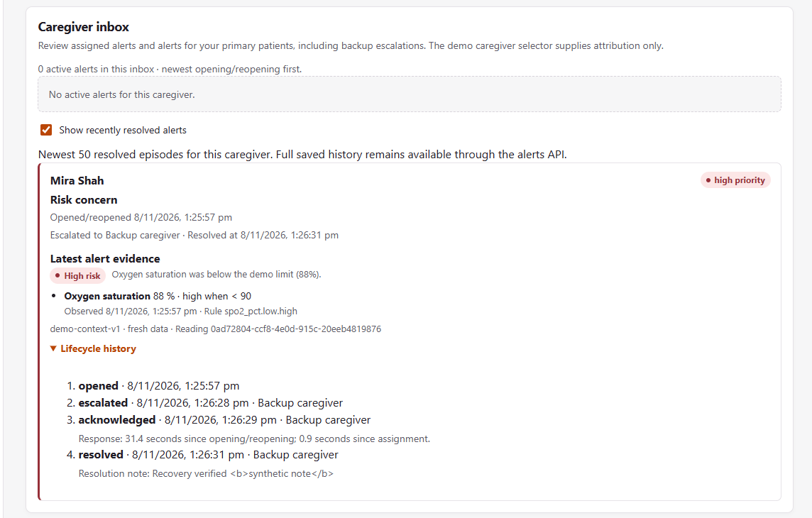
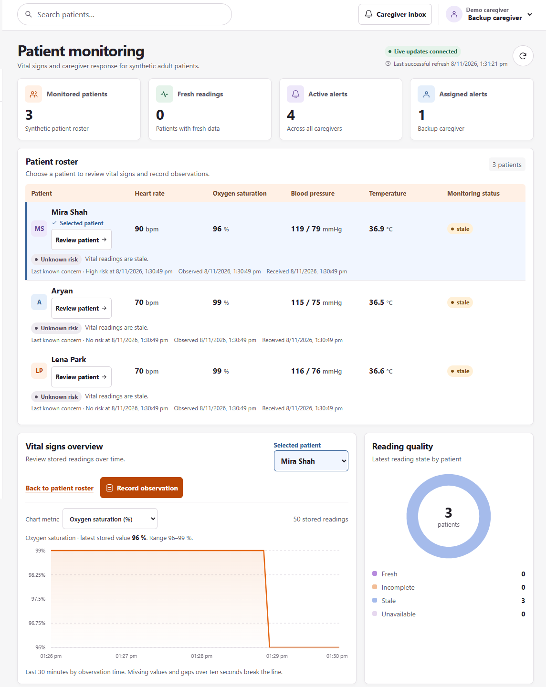

# Operation Ward Zero technical documentation

Operation Ward Zero is a local hackathon prototype for home health monitoring and caregiver response. It demonstrates a complete workflow using synthetic measurements for three fictional adults and two seeded caregiver roles.

## 1. Problem understanding

A monitoring system needs to distinguish a concerning measurement from an absent, incomplete, or stale measurement. A network interruption can delay delivery while the monitor continues sampling. When the connection returns, recovered readings should be reviewable without replacing newer readings on the dashboard. The caregiver workflow also needs a record of what triggered an alert, who responded, and whether it was resolved.

## 2. Proposed solution

A Python simulator samples each patient and saves every frame locally before upload. FastAPI validates incoming frames, evaluates deterministic rules, and commits the reading and its effects to PostgreSQL. A React dashboard displays both concern and reading quality. The caregiver inbox shows the evidence, current assignee, and saved lifecycle. An unanswered alert can escalate to a backup caregiver. After an outage, a reconciliation command compares reading UUIDs in SQLite and PostgreSQL.

## 3. System architecture

Docker Compose runs the simulator, application, and database as separate services. The application serves the React bundle and REST and WebSocket endpoints on the same loopback-bound port. SQLite and PostgreSQL use separate named volumes.

PostgreSQL is authoritative for accepted readings and caregiver state. SQLite retains the simulator payload and its delivery state. WebSocket hints tell the browser which REST data to refresh.

| PostgreSQL records | Purpose |
|---|---|
| Patients, devices, and caregivers | Map each monitor to its patient, assign primary and backup roles, and track the patient's latest reading and current assessment. |
| Readings and observations | Preserve vital measurements with observation and receipt times, and separately preserve structured caregiver reports with server-assigned times. |
| Assessments | Record rule version, current or historical scope, concern, data quality, findings, and contributing evidence. |
| Alerts and alert events | Record episode state, assignee, deadline, original and latest evidence, and the chronological action history. |

## 4. Technology stack

| Layer | Implementation |
|---|---|
| Application | Python 3.13, FastAPI, Pydantic, and one Uvicorn worker |
| Server storage | PostgreSQL 17, SQLAlchemy async, asyncpg, and Alembic. The migration head is `0009_caregiver_labels`. |
| Simulator | Python standard library, including `sqlite3` and `urllib` |
| Browser | React, TypeScript, Vite, TanStack Query, and Recharts. Node.js 22 builds the static bundle in Docker. |
| Packaging | Docker Compose, digest-pinned base images, a hash-locked Python requirements file, and an npm lockfile |
| Verification | pytest with real PostgreSQL, Python unittest for the simulator, strict TypeScript and the production build, Playwright with Microsoft Edge, and FFmpeg for demo recordings |

## 5. Major features

- **Monitoring.** The roster shows the latest stored vitals and timestamps alongside fresh, incomplete, stale, or unavailable reading status. The history chart uses observation time and breaks its line at missing values or gaps.
- **Context and explanation.** Caregivers can review supported trends, enter structured observations, and inspect the stored evidence behind a concern.
- **Caregiver workflow.** The inbox shows active episodes, current assignment, saved deadlines, recovery progress, and lifecycle history. The resolved archive displays the selected caregiver's recent resolved episodes.
- **Operational visibility.** The dashboard separates browser synchronization from patient freshness and shows service readiness. It labels cached snapshots when a refresh cannot verify them.

*Figure 1. The live dashboard shows three fictional patients, the selected patient's SpO₂ history, and the reading quality summary.*

## 6. Patient data collection and processing

Each simulated monitor produces a frame every five seconds. The frame contains heart rate in bpm, SpO₂ in percent, systolic and diastolic blood pressure in mmHg, and temperature in °C. A missing measurement is represented as `null`. The simulator assigns a reading UUID and a sequence that persists for the registered device.

The ingestion endpoint requires a simulator key and derives the patient from the device registration. It validates the payload, including finite measurements, valid SpO₂ bounds, consistent blood pressure values, and a timezone-aware observation timestamp. Timestamps more than five seconds ahead of the server are rejected.

The API records observation time and server receipt time separately. The dashboard marks a reading as delayed when receipt is more than ten seconds after observation. Historical frames remain queryable and can contribute to later eligible trend windows. An older frame cannot replace a newer current reading. Historical assessment applies absolute thresholds and routes breaches to delayed review.

## 7. Risk assessment methodology

The assessment combines deterministic thresholds, descriptive trends, and structured observations. The values below are demo parameters. Threshold comparisons are strict, and High takes precedence for a metric.

| Measurement | Watch | High |
|---|---|---|
| Heart rate | <50 or >110 bpm | <40 or >130 bpm |
| SpO₂ | <94% | <90% |
| Systolic blood pressure | <90 or >160 mmHg | <80 or >180 mmHg |
| Diastolic blood pressure | <50 or >100 mmHg | <40 or >120 mmHg |
| Temperature | <36 or >38 °C | <35 or >39 °C |

**Trends.** The system compares medians in the two adjacent one-minute windows ending at the eligible latest reading. Each metric needs at least eight valid samples in each window, with no gap greater than ten seconds, including the outer window edges. A SpO₂ decline of at least three percentage points or a heart-rate increase of at least 20 bpm triggers Watch.

**Observations.** A caregiver can mark breathlessness, dizziness, or reduced intake as present or clear the tag. The latest entry for each tag controls its state. A present tag expires after ten minutes. An active tag raises concern to at least Watch. Breathlessness together with a current SpO₂ threshold breach or supported falling SpO₂ trend raises High. Optional notes are stored and displayed as entered.

**Display and evidence.** A complete assessment with no firing rule displays No risk. One distinct Watch signal displays Low, two or more display Medium, and a High finding displays High. Signals are counted by metric or observation tag. Insufficient evidence can display Unknown, and a supported concern can coexist with incomplete data. When available, the previous known concern and its timestamp remain visible separately. Saved evidence includes rule IDs and version, values and units, timestamps, reading UUIDs, trend-window summaries, and contributing observations.

*Figure 2. The stored assessment shows the median SpO₂ decline from 99% to 96%, the recorded breathlessness observation, and the rule that combines them.*

## 8. Alert generation, acknowledgement and escalation

One active episode per patient and kind aggregates repeated evidence. Episodes preserve opening evidence and peak priority while adding the latest evidence and lifecycle events. A higher priority or a new concern after recovery can reopen an acknowledged risk episode and start a new primary response cycle.

| Episode | Trigger | Resolution |
|---|---|---|
| Risk | Current threshold, trend, or observation finding | The current assignee acknowledges and enters a note. Three consecutive new, fresh, complete readings with no firing rules must qualify, and the last must still be fresh. |
| Monitoring gap | No complete recent observation within the 30-second freshness window | Closes automatically after three qualifying fresh complete readings. |
| Delayed review | A historical reading triggers a threshold rule | The current assignee acknowledges and records a review note. |

PostgreSQL saves each escalation deadline. The demo deadlines are 30 seconds for High and 60 seconds for Watch. A rise to High can shorten a pending deadline. The periodic check hands an unanswered episode to the backup once. The primary caregiver can still see the active episode, and only the current assignee can acknowledge or manually resolve it. Acknowledgement clears the pending deadline. The audit history records actors, event times, response time from the opening or reopening, time from assignment, and the resolution note.

*Figure 3. A separate lifecycle regression fixture shows the resolved inbox and the saved primary-to-backup response history.*

## 9. Data reliability and recovery

1. **Commit before upload.** The simulator writes the frame and sequence to SQLite before sending it. A separate uploader works from the oldest pending frame, retries transient failures with capped backoff and jitter, and retains permanently rejected frames in quarantine.
2. **Commit before receipt.** FastAPI locks the affected patient and commits the reading, assessment, alert changes, and audit events in one PostgreSQL transaction. A matching UUID and payload returns the original receipt on retry. Conflicting reuse of the reading ID or device sequence returns HTTP 409.
3. **Recover work on restart.** Named volumes retain buffered frames, accepted readings, and lifecycle state. The application processes overdue freshness, observation expiry, and escalation checks before it reports ready.
4. **Reconcile browser state.** REST snapshots restore authoritative state on reconnect. The browser polls every 15 seconds when the WebSocket is connected and every five seconds otherwise. Unconfirmed caregiver actions retain their original payloads and IDs for retry.
5. **Verify recovery by ID.** Stop sampling, drain uploads, and compare locally committed UUIDs with server-stored, pending, and quarantined UUIDs. The sets must account for every committed frame without overlap. A fully drained fixture of valid frames has empty pending and quarantine sets.

*Figure 4. The simulator's network was disconnected while the dashboard remained connected to FastAPI. The three stale indicators reflect missing new patient readings.*

The recorded acceptance run passed 19 checks, including 93 PostgreSQL-backed tests, seven simulator tests, and two full browser rehearsals. Each rehearsal retained 18 pending frames during a real simulator network disconnection, matched 171 of 171 IDs after replay, and matched 186 of 186 at completion. Each also compared the resolved episode and its lifecycle history before and after a real application restart and found them identical. The broader failure checks covered application and database outages, simulator restart, and loss of a receipt after commit.

## 10. Assumptions and limitations

- All patients, readings, observations, rules, and accelerated deadlines are for demonstration. Concern levels describe evidence against configured rules. Clinical interpretation and validation would require separate work.
- The system uses deterministic rules and descriptive history. Predictive models and interpretation of caregiver notes are outside its scope.
- The two seeded caregiver selections provide demo attribution. The prototype serves a local loopback UI and uses in-app routing.
- Durability assumes available storage and intact named volumes. The prototype retains records and requires manual inspection of quarantined frames.
- The rehearsals exercise a single application worker and short continuous runs. Capacity, long-duration reliability, and real device behavior remain untested.

## 11. Future improvements

Integrate and validate physical monitoring devices. Add authenticated caregiver identities and role enforcement, external delivery with response tracking, and operational controls for storage growth, retention, backups, and restoration. Exercise sustained outages and higher volume in dedicated reliability tests. Review measurement quality, thresholds, and alert workflows with clinical stakeholders before considering real-world use.

For reproducible startup and demo commands, see the [demo runbook](DEMO_RUNBOOK.md). The [verification record](IMPLEMENTATION_PLAN.md) contains the commands, results, and evidence locations for the tested source.
